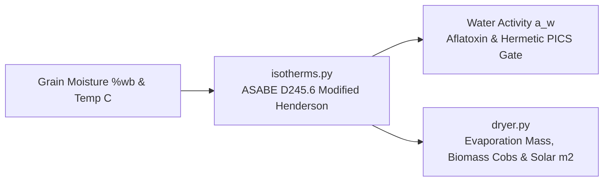

# grain-dry

[](https://github.com/codesphere-u/grain-dry/actions/workflows/ci.yml)
[](LICENSE)
[](pyproject.toml)
[](pyproject.toml)

**Zero-dependency post-harvest grain drying & food safety toolkit: ASABE D245.6 Modified Henderson sorption isotherms, water-activity aflatoxin gates, solar/biomass batch dryer energy balance, and safe storage limits.**

- **Mission Domain:** AgriTech & Post-Harvest Food Safety
- **Stack:** Pure Python 3.11+ (zero runtime third-party dependencies, `mypy --strict`, `ruff`, `pytest`)
- **Maintainer:** Codesphere Innovations (U) Limited (`codesphere-u`)

---

## Problem Solved

Aflatoxin B1 contamination in maize and groundnuts causes severe liver cancer and export rejections across Africa because farmers rely on fixed moisture guesses instead of temperature-dependent water activity (`a_w < 0.65`).

## Key Features

- Published ASABE D245.6 Modified Henderson sorption isotherms (`equilibrium_water_activity`, `equilibrium_moisture_wb_pct`) for yellow maize, rough rice, sorghum, soybean, groundnut kernels, and robusta coffee.
- Water-activity *Aspergillus flavus* aflatoxin & hermetic PICS-bag safety gate (`assess_storage_safety`) showing why oil-rich groundnuts must dry below ~7% wb while maize is safe near ~12.5% wb.
- Solar & biomass batch dryer mass-energy balance (`plan_batch_drying`) computing evaporated water mass, maize-cob fuel kg, solar collector area `m2`, and seed/milling temperature guards.

## Architecture Overview



See [docs/architecture.md](docs/architecture.md) for module-level design details.

## Installation

```bash
git clone https://github.com/codesphere-u/grain-dry.git
cd grain-dry
uv sync --extra dev
```

Or install in editable mode with standard `pip`:

```bash
pip install -e ".[dev]"
```

## Quick Start (CLI)

```bash
grain-dry --grain groundnut_kernel --batch-kg 500 --moisture 12.0 --storage-temp 30
```

## Quick Start (Python API)

```python
from grain_dry import StorageRiskLevel, assess_storage_safety

res = assess_storage_safety('groundnut_kernel', moisture_wb_pct=12.0, storage_temp_c=30.0)
assert res.risk_level == StorageRiskLevel.CRITICAL_AFLATOXIN_RISK
```

## Testing & Quality Gates

```bash
uv run ruff check src tests
uv run mypy src
uv run pytest -v
```

## Security, Contributing & Roadmap

- **Security:** See [SECURITY.md](SECURITY.md) for responsible disclosure procedures.
- **Contributing:** See [CONTRIBUTING.md](CONTRIBUTING.md) and [CODE_OF_CONDUCT.md](CODE_OF_CONDUCT.md).
- **Changelog & Roadmap:** See [CHANGELOG.md](CHANGELOG.md) and [ROADMAP.md](ROADMAP.md).

## License

MIT License — see [LICENSE](LICENSE).

## Support & Contact

Open an issue on [GitHub Issues](https://github.com/codesphere-u/grain-dry/issues) or contact `codesphereinnovationz@gmail.com`.
